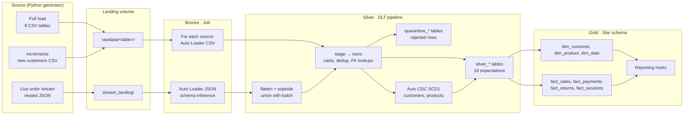
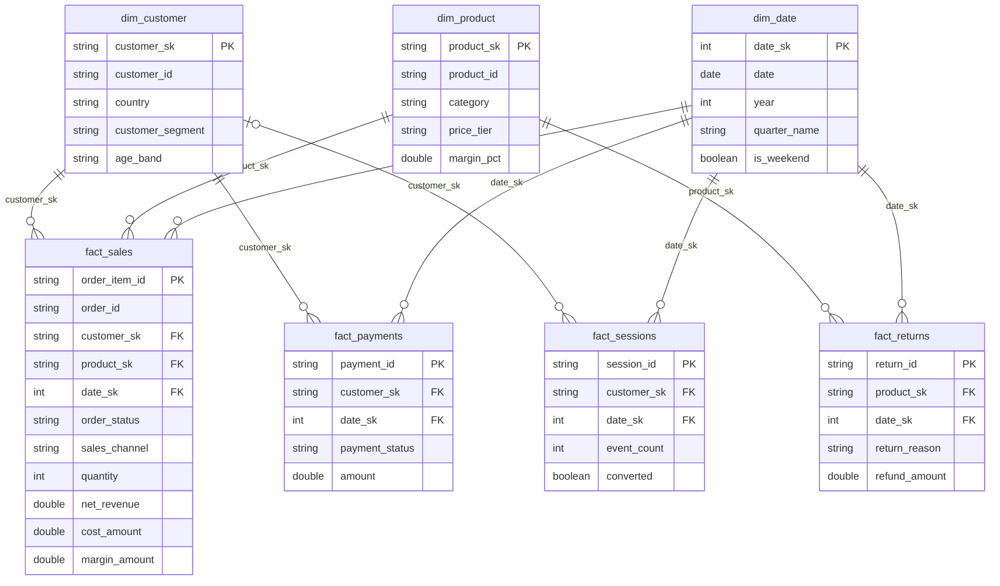

# E-commerce Lakehouse on Databricks

End-to-end data engineering project: a synthetic European e-commerce business (3.5M+ rows, 9 source tables) goes from raw files to an analytics-ready **Kimball star schema**, built on a **medallion architecture** (Bronze → Silver → Gold) with **Delta Live Tables** and **Unity Catalog** on Databricks.

**Stack:** Python · PySpark · Spark SQL · Databricks (Free Edition) · Delta Live Tables · Auto Loader · Unity Catalog · Delta Lake

## Architecture



## Repository structure

```
├── data_generator/   # synthetic source data: full load, increments, live stream
├── pipelines/
│   ├── bronze/       # metadata-driven Auto Loader ingestion
│   ├── silver/       # DLT: cleaning, deduplication, expectations, quarantine
│   └── gold/         # star schema, reporting marts, incremental SCD1 dimension
├── setup/            # one-time Unity Catalog setup, stream simulator
├── jobs/             # job definition (For each loop over sources)
├── tests/            # validation queries between layers
├── docs/             # diagrams and design decisions
└── data/raw/         # generated files (git-ignored, reproducible)
```

## 1. Source data

The source system is simulated in Python, so the project needs no paid data or cloud infrastructure. The data is realistic in the ways that matter for data engineering:

- **9 related tables:** customers, products, orders, order items, payments, shipments, returns, web events and reviews.
- **Seasonality and growth:** a Black Friday peak, a February trough, and 18–38% year-on-year growth.
- **Deliberate data-quality problems** in ~0.5% of rows per issue type: duplicates, orphan keys, impossible dates and amount mismatches. The pipeline has to detect and fix them.
- **Three ingestion patterns:** a historical batch load, incremental batches, and a real-time JSON stream for Auto Loader.

Details: [`data_generator/README.md`](data_generator/README.md)

## 2. Bronze layer: metadata-driven ingestion

All 9 sources are loaded by **one** parameterized notebook. There is no copy-pasted notebook per table.

| Step | File | What it does |
|---|---|---|
| 1 | [`01_source_list.py`](pipelines/bronze/01_source_list.py) | Publishes the list of source tables as a job **task value** |
| 2 | [`02_bronze_ingestion.py`](pipelines/bronze/02_bronze_ingestion.py) | Generic **Auto Loader** ingestion: the `src` parameter picks the table |
| 3 | [`03_bronze_orders_stream.py`](pipelines/bronze/03_bronze_orders_stream.py) | **Real-time order stream:** Auto Loader on nested JSON, with schema inference and schema hints |
| — | [`jobs/bronze_ingestion_job.yml`](jobs/bronze_ingestion_job.yml) | A **For each** task runs step 2 once per table, 3 in parallel. Step 3 runs alongside it. |

- **Incremental:** the Auto Loader checkpoint tracks processed files, so a new increment file (e.g. new customers) is picked up on its own and nothing is reloaded.
- **`trigger(availableNow=True)`:** streaming semantics with batch cost. The job processes everything new and then stops.
- **Schema evolution in `rescue` mode:** unexpected columns or types land in `_rescued_data` instead of breaking the load.
- **Adding a new source** means adding one line to the source list. No new code.
- **Two source formats:** flat CSV for the batch sources, and nested JSON for the order stream. Bronze stores both as received. The JSON stream also records lineage: the source file and the load time of every row.

## 3. Silver layer: data quality with Lakeflow Declarative Pipelines (DLT)

[`silver_pipeline.py`](pipelines/silver/silver_pipeline.py) is one DLT pipeline for all 9 datasets. Every dataset follows the same flow:

```
stage_<x>  ──▶  trans_<x>  ──┬──▶  silver_<x>       rows that pass every rule
(stream from    (casts,      │
 bronze)         dedup, FK   └──▶  quarantine_<x>   rejected rows, kept for inspection
                 lookups)
```

- **33 expectations** (`expect_all_or_drop`). Each one maps to a data-quality issue injected by the generator, so the quarantine counts can be checked against the generation report.
- **Rejected rows are never lost silently.** They go to a quarantine table, where the reason can be inspected.
- **Referential integrity** is checked against the cleaned parent tables: orders → customers, order items → products, payments → orders.
- **Cross-table business rules:** the payment amount must match the sum of its order lines. A return cannot happen before delivery, and the refund cannot exceed the price paid. A captured payment cannot belong to a cancelled order.
- **Auto CDC (SCD Type 1)** for `customers` and `products` with `create_auto_cdc_flow`. New or changed records from incremental files are upserted, not appended as duplicates.
- **Absences are audited separately.** A completed order without a shipment is not a bad row, so it goes to `audit_orders_missing_shipment` instead of being dropped.
- **Stage tables are generated in a loop**, so adding a dataset means adding one name to the list.
- **Batch and stream merged into one model.** Streamed orders are flattened, and their `items` array is exploded into order lines. They are then unioned with the batch orders *before* the rules run, so every order passes the same checks. A `source_system` column keeps the origin. The stream has its own extra check: the order total must equal the sum of its lines.

## 4. Gold layer: dimensional model

[`01_gold_star_schema.py`](pipelines/gold/01_gold_star_schema.py) builds a **Kimball star schema** from the silver tables and the reporting marts on top of it.



| Type | Tables |
|---|---|
| Dimensions | `dim_customer` (age band), `dim_product` (margin, price tier), `dim_date` (generated calendar) |
| Facts | `fact_sales` (grain: order line, with revenue, cost and margin), `fact_payments`, `fact_returns`, `fact_sessions` (clickstream sessionized, with funnel flags and conversion attribution) |
| Marts | `mart_sales_summary`, `mart_product_performance`, `mart_customer_360` (lifecycle: Active / Lapsing / Churned), `mart_web_funnel_weekly` |

- **Surrogate keys:** deterministic hash of the natural key (`sha2`), stable across reruns.
- **Idempotent:** every table is written with `overwrite`, so a rerun gives the same result.
- **PK/FK constraints** (`RELY`) are declared in Unity Catalog, so BI tools (Power BI, Tableau) detect the relationships automatically.

[`02_dim_customer_incremental_scd1.py`](pipelines/gold/02_dim_customer_incremental_scd1.py) shows the alternative to a full rebuild: a **generic, parameter-driven incremental load** for a dimension. It works with a watermark on the CDC column and supports a back-dated refresh. Existing keys are preserved, new members get sequential surrogate keys, and the result is applied with a Delta **MERGE** (SCD Type 1).

## Screenshots

<!-- Add the images to docs/screenshots/ (see docs/screenshots/README.md), then remove this comment.


-->

## How to run

Tested on **Databricks Free Edition** (serverless).

1. **Generate the data** locally: `pip install -r requirements.txt`, then `python data_generator/generate_all.py`.
2. **Clone this repo into Databricks** as a Git folder: Workspace → Create → Git folder.
3. **Run** [`setup/00_setup_unity_catalog.py`](setup/00_setup_unity_catalog.py). It creates the catalog, the schemas, the volumes and one landing folder per table.
4. **Upload** each CSV into its folder, e.g. `rawdata/customers/customers.csv`.
5. **Run** [`setup/01_simulate_order_stream.py`](setup/01_simulate_order_stream.py) to drop live orders into `stream_landing/`.
6. **Run the `bronze_ingestion` job**, as defined in [`jobs/bronze_ingestion_job.yml`](jobs/bronze_ingestion_job.yml).
7. **Run the silver pipeline**, with [`pipelines/silver/silver_pipeline.py`](pipelines/silver/silver_pipeline.py) as its source.
8. **Run** [`pipelines/gold/01_gold_star_schema.py`](pipelines/gold/01_gold_star_schema.py).
9. **Check the results** with [`tests/validation_queries.sql`](tests/validation_queries.sql).

To see the incremental processing at work, upload a `customers_increment_*.csv` file or run step 5 again, then rerun steps 6–8. Only the new files are processed.
